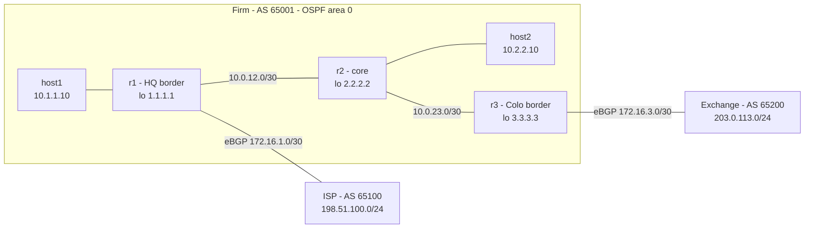

# Mini Colo Network Lab

A two-site trading-firm network built as code with Containerlab and FRRouting. It runs OSPF inside the firm, eBGP to an ISP and a stock exchange, and an iBGP full mesh between the firm's routers. I'm using it to learn how ARP, OSPF, and BGP behave, and how they fail.

> **Status:** Steps 1–4 complete (working network). Step 5+ (deliberate failure injection, packet captures, convergence measurement, automated monitoring) in progress.

## Topology



| Node | Role | AS | Loopback | Protocols |
|---|---|---|---|---|
| r1 | HQ border router | 65001 | 1.1.1.1/32 | OSPF, iBGP, eBGP to ISP |
| r2 | Core router | 65001 | 2.2.2.2/32 | OSPF, iBGP |
| r3 | Colo border router | 65001 | 3.3.3.3/32 | OSPF, iBGP, eBGP to Exchange |
| isp | Simulated ISP | 65100 | 198.51.100.1/24 | eBGP |
| exch | Simulated exchange | 65200 | 203.0.113.1/24 | eBGP |
| host1, host2 | End hosts | - | - | default gateway to r1 / r2 |

All addresses use private or documentation ranges (RFC 1918, RFC 5737), and AS numbers are from the private range (64512–65534).

## Design decisions

- **OSPF inside, BGP at the edges.** OSPF shares a full topology map, which is right inside one organization but not with outside companies. BGP exchanges only reachability and lets each side apply its own policy.
- **iBGP between loopbacks.** Loopbacks never go down, so if a physical link fails, OSPF reroutes to the loopback and the BGP session survives.
- **iBGP full mesh (including r2).** r2 sits in the forwarding path between the borders. Without BGP routes it would black-hole traffic to external prefixes. And because of iBGP split horizon, a router won't pass iBGP-learned routes to other iBGP peers, so every router peers with every other.
- **`next-hop-self` on the border routers.** Without it, internal routers would see the external peer's address (e.g. 172.16.1.2) as the next hop. That subnet isn't in OSPF, so the route would be unusable.
- **OSPF point-to-point links.** Each router link has exactly two routers, so DR/BDR election is unnecessary.
- **Passive OSPF on host-facing interfaces.** The host subnets are advertised, but no OSPF Hellos are sent toward hosts.

## How to run it

Requires Docker and [Containerlab](https://containerlab.dev). Developed on an M1 Mac using an OrbStack Ubuntu 24.04 VM.

```bash
git clone https://github.com/bonsny/mini-colo-network-lab.git
cd mini-colo-network-lab
containerlab deploy -t lab.clab.yml
```

Wait about 60 seconds for OSPF and BGP to converge, then verify:

```bash
# OSPF neighbors (expect 1.1.1.1 and 3.3.3.3 in Full/-)
docker exec clab-mini-colo-r2 vtysh -c "show ip ospf neighbor"

# BGP sessions (expect a number, not a word, in State/PfxRcd)
docker exec clab-mini-colo-r1 vtysh -c "show bgp summary"

# End-to-end: HQ host to the exchange (expect 0% loss, ttl=61)
docker exec clab-mini-colo-host1 ping -c 3 203.0.113.1
docker exec clab-mini-colo-host1 traceroute -n 203.0.113.1
```

Tear down with `containerlab destroy -t lab.clab.yml`.

## What I observed

- **TTL counts the routers in the path.** Pinging r1 directly returned `ttl=64`, but pinging the exchange returned `ttl=61`. Each router decrements the TTL by 1, so that's 3 routers (r1, r2, r3). Traceroute confirmed the same three hops in order.

- **The first ping is slower because of ARP.** Before pinging r1, host1's ARP cache (`ip neigh`) was empty. The first ping took 1.73 ms, and the next two took about 0.11 ms, roughly 15x faster. The first packet had to wait while host1 broadcast "who has 10.1.1.1?" and r1 replied with its MAC. Afterwards the cache held `10.1.1.1 lladdr aa:c1:ab:85:5a:f3`, which matched r1's `eth1` MAC exactly, so later pings went straight out.

- **An OSPF neighbor stuck in `Init` means the Hellos are only one-way.** Checking about 6 seconds after deploy, r2 showed r1 in `Init/-`. Init means r2 has received r1's Hello, but r1's Hello doesn't yet list r2 as a neighbor it has heard. A minute later both neighbors were `Full/-`. A neighbor that *stays* in Init points to one-way communication (a filter, a link problem, or an ACL dropping Hellos in one direction), not a timing issue.

- **`Full/-` means no DR on point-to-point links.** The dash after Full is the neighbor's DR/BDR role, and it's empty because I set `ip ospf network point-to-point`. DR/BDR election only exists on shared (broadcast) segments, where many routers would otherwise all form adjacencies with each other. On a link with exactly two routers there's nothing to optimize, so OSPF skips the election, which also makes adjacencies form faster. `show ip ospf interface` confirmed `Network Type POINTOPOINT` and `No backup designated router on this network`.


## Known gaps

- **Route leak:** `no bgp ebgp-requires-policy` is set to keep the first build simple, so the firm currently advertises the exchange's prefix to the ISP, making it a transit network. The fix is inbound and outbound route-maps on the eBGP sessions.

## Roadmap

- [x] ARP, OSPF, and BGP working across two sites
- [ ] Inject failures (OSPF MTU/timer mismatch, missing next-hop-self, session loss, duplicate IP, failover without gratuitous ARP) and document each
- [ ] Packet captures of each failure
- [ ] Measure convergence time with a Python UDP prober, before and after BFD
- [ ] Python monitor that detects and diagnoses failures
- [ ] ARP implemented from scratch with Scapy
- [ ] Route policy to fix the route leak

## Repo layout

```
lab.clab.yml        # Containerlab topology (nodes + links)
configs/<node>/     # FRR config per router: frr.conf, daemons, vtysh.conf
notes.md            # Running learning log
```
